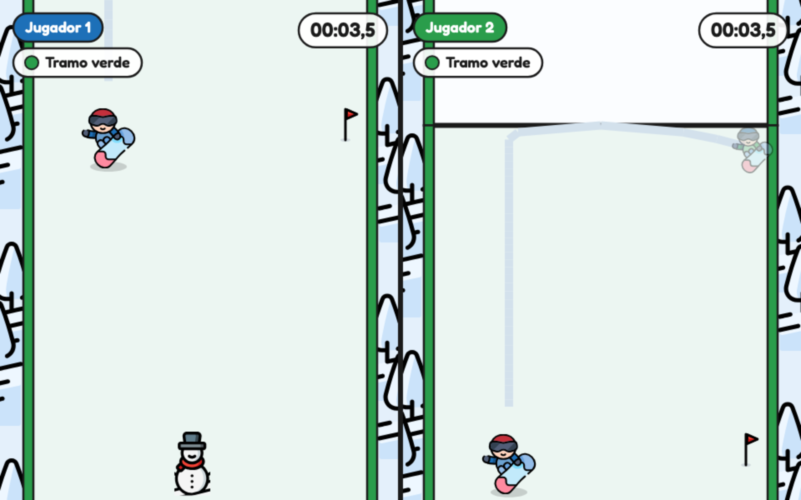

# Snowboard

Juego de carreras de snowboard en 2D para el navegador, para uno o dos jugadores en el mismo teclado, o para uno en el celular. Es una demo para una clase universitaria sobre cómo construir un proyecto con ayuda de IA.



## Cómo jugar

| Acción | Jugador 1 | Jugador 2 |
| --- | --- | --- |
| Moverse | `A` / `D` | `←` / `→` |
| Acelerar | `S` | `↓` |
| Saltar | `W` | `↑` |

Si juega una sola persona, usa las flechas. Mientras se mantiene el acelerador se gana velocidad, hasta tres veces la base del tramo; al soltarlo se frena hasta detenerse en dos segundos.

En el celular se juega en vertical y con los dos pulgares: el dedo apoyado en la mitad izquierda maneja un joystick para moverse a los costados, y en la mitad derecha están los botones «Acelerar» (mantener) y «Saltar» (tocar). Los menús se manejan tocando.

En los menús se navega con las flechas y se acepta con `Enter`. `Esc` vuelve al menú. `F` activa o desactiva la pantalla completa (salvo en la preparación).

Jugar en línea: https://fedegonzal.github.io/snowboard-game

## Requisitos

- Node.js 20 o superior.
- Chrome o Firefox de escritorio, o el navegador de un celular.

## Ejecución

```
npm install
npm run dev
```

Abrir la dirección local que indica Vite (por defecto `http://localhost:5173`). Para generar una versión estática: `npm run build`, que la deja en `dist/`.

## Estructura

```
docs/            Necesidades, especificación, arquitectura, plan y tareas
public/assets/   Ilustraciones SVG exportadas de Figma y efectos de sonido (sounds/)
src/game/        Reglas del juego (sin dependencias de Phaser)
src/render/      Dibujo de la pista, el jugador, el HUD, la interfaz y los sonidos
src/scenes/      Escenas de Phaser: menú, preparación, carrera, resultado y top 10
src/config.js    Valores ajustables: velocidades, tiempos, tablas, colores y teclas
supabase/        Esquema de la tabla del top 10
tools/           Generador de los efectos de sonido
```

Los sonidos se sintetizan con `python3 tools/generate-sounds.py` (solo biblioteca estándar).

## Top 10 compartido

El top 10 se guarda en [Supabase](https://supabase.com). Para usar un proyecto propio: ejecutar `supabase/schema.sql` en su SQL Editor y poner la URL y la clave pública (`anon`) en `SUPABASE` de `src/config.js`. La clave pública puede estar en el código: los permisos solo dejan leer e insertar tiempos.

## Documentación

- [Especificación](docs/spec.md)
- [Arquitectura](docs/architec.md)
- [Plan](docs/plan.md) y [tareas](docs/tasks.md)
- [Diseño en Figma](https://www.figma.com/design/XJvLyYUUMLWfXdVWqBHq7s/snowboard?node-id=3-2)
